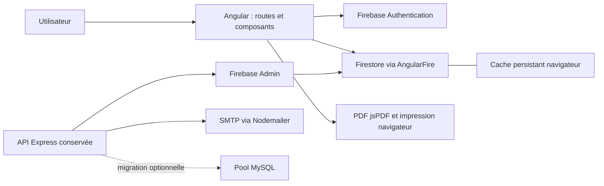

# AUDIT INITIAL — SUPERVISION-VISIOS

Date : 27 octobre 2026. Mission exclusivement analytique.

Projet examiné : `C:/Users/koffi/Documents/PROJETS JS/SUPERVISION-VISIOS`.

## 1. Résumé exécutif du projet

SUPERVISION-VISIOS gère les référentiels pédagogiques, les séances planifiées, les fiches de supervision synchrone et asynchrone, leurs historiques et documents imprimables. Le nom déclaré du frontend est `supervision-visios`, version applicative `0.0.0`; celui du backend est `supervision-visios-backend`, version `1.0.0`.

**Constat central : deux architectures et plusieurs formats de données coexistent.** Le frontend actuel utilise directement Firebase Authentication et Firestore. L'API Express subsiste, avec une authentification et des transformations différentes. Les commentaires évoquant un backend MySQL ne décrivent pas le chemin actuel d'enregistrement du formulaire. Cette divergence explique plusieurs anomalies fonctionnelles.

Les urgences sont :

1. Vérifier les règles réellement déployées : le fichier local `firestore.rules:5` autorise toutes les lectures et écritures, sans authentification.
2. Préserver les données lors des modifications : le chargeur du formulaire ignore une partie des champs produits par son propre enregistrement et les variantes historiques. Un contrôle isolé sur la méthode réelle reproduit les pertes de valeurs.
3. Clarifier les droits : le guard vérifie seulement un profil local; certaines vues utilisent `id` quand Firebase fournit `uid`; l'historique asynchrone est chargé sans filtre utilisateur.
4. Sécuriser ou retirer du périmètre exposé les anciens endpoints : inscription publique acceptant le rôle fourni, secret JWT de secours codé en dur, création de mots de passe en clair, routes classes/parcours sans middleware d'authentification.
5. Considérer les honoraires comme un modèle partiel : le template courant contient des lignes et totaux vides, et son contrôleur attend un format qui n'est pas celui des nouvelles fiches.

Les emplois du temps enseignants sont réalisables à partir des plannings. Le préremplissage des honoraires requiert d'abord une normalisation des données et des règles métier validées. L'envoi d'e-mails est bloqué dans le service frontend; un mécanisme SMTP existe dans l'API mais n'est pas relié au parcours courant.

### Méthode et limites de preuve

- **Fait vérifié** : lecture du code/configuration, inventaire local, état Git, version installée ou résultat d'une vérification réellement exécutée.
- **Hypothèse / risque plausible** : effet dépendant du contenu réel de Firestore, des règles déployées, du réseau ou du navigateur.
- **Proposition** : futur chantier, sans implémentation dans cette mission.
- Les références ci-dessous sont des chemins réels relatifs à la racine absolue du projet indiquée en tête. Les lignes désignent l'état local audité, y compris les modifications préexistantes.
- L'inventaire couvre les routes, composants, services, contrôleurs, configurations et tests recensés. Il ne constitue pas une validation exhaustive de chaque comportement en exécution.
- Aucun accès à Firestore distant, aucune connexion applicative, aucune requête vers l'API, aucun envoi d'e-mail, migration, installation, déploiement ou test de charge. Aucun secret ni donnée personnelle n'est reproduit.

## 2. Architecture technique réelle

### 2.1 Chemin principal du frontend

`FRONT/src/main.ts` démarre l'application Angular. `app.config.ts:12-29` fournit le routeur, HttpClient, Firebase App, Firebase Auth, Firestore avec cache local persistant multi-onglets et le service worker de production.



Le schéma n'affirme pas que l'API est déployée ou effectivement utilisée en production. Les services métier Angular examinés effectuent leurs CRUD par AngularFire. `environment.prod.ts:3` conserve une URL Render d'API, mais sa déclaration n'établit pas un appel effectif. Les quatre intercepteurs HTTP présents ne sont pas enregistrés dans `app.config.ts:17` : `provideHttpClient(withFetch())` n'active pas leurs fonctions. Ils ne protègent pas non plus les appels du SDK Firestore.

### 2.2 Backend conservé

`BACKEND/src/server.ts:18-42` crée Express, active CORS avec réflexion de l'origine et credentials, accepte du JSON jusqu'à `50mb`, monte neuf groupes `/api/*`, puis exporte une fonction HTTPS Firebase. `server.ts:46-50` démarre aussi un serveur local si exécuté directement.

`config/db.ts:10-36` ne crée le pool MySQL que si ses variables sont définies; son commentaire le réserve aux migrations. `db.ts:40-82` initialise Firebase Admin depuis une variable d'environnement, un fichier local de compte de service ou les credentials par défaut. Les contrôleurs métier actifs utilisent Firestore. La présence de `pg` n'établit pas l'existence d'une base PostgreSQL utilisée par ces parcours.

### 2.3 Services externes et déploiement

| Service / support | Rôle observé | Preuve et limite |
|---|---|---|
| Firebase Authentication | Connexion e-mail/mot de passe et création de comptes côté frontend | `services/auth.service.ts:73-94`, `user.service.ts:40-87` |
| Cloud Firestore | Référentiels, fiches, plannings, activités et notifications | Services AngularFire et contrôleurs Admin SDK |
| Firebase Hosting | Cible de déploiement configurée | `firebase.json:10-23`, `package.json:3-4`; état déployé non vérifié |
| Vercel | Réécriture SPA alternative | `FRONT/vercel.json:1-12`; pas une preuve d'hébergement actif |
| Render | Adresse API de production déclarée | `FRONT/src/environments/environment.prod.ts:3`; disponibilité non testée |
| Firebase Functions | Export d'API présent | `BACKEND/src/server.ts:42`; aucune section Functions dans le `firebase.json` racine examiné |
| SMTP / Nodemailer | Envoi serveur avec pièces jointes | `BACKEND/src/utils/emailService.ts:6-30`; configuration réelle non testée |
| Google Fonts / Material Symbols | Police et pictogrammes distants | `FRONT/src/index.html:11-14`; dépendance réseau visuelle |
| Zoom, Teams, Meet | Valeurs de plateforme dans la fiche | `supervision-form.html:96-100`; aucune intégration de leurs API démontrée |

Le document `ARCHITECTURE.md:13-20` présente un flux REST et une CI GitHub Actions; ce n'est pas la description du flux direct Firestore constaté. Aucun dossier `.github` n'a été trouvé à la racine. Les mentions de Sentry/monitoring dans ce document ne constituent pas une instrumentation prouvée.

## 3. Technologies et versions

Versions installées lues dans les `node_modules/*/package.json`, sans installation ni mise à jour. Ce tableau décrit l'état local, pas un audit de vulnérabilités des versions.

| Ensemble | Déclaré | Installé localement |
|---|---|---|
| Angular common/compiler/core/forms/platform-browser/router/service-worker | `^20.3.0` | `20.3.17` chacun |
| Angular CLI / build | `^20.3.7` | `20.3.18` |
| Angular compiler-cli | `^20.3.0` | `20.3.17` |
| AngularFire | `^20.0.1` | `20.0.1` |
| Firebase frontend | `^11.8.0` | `11.10.0` |
| TypeScript frontend | `~5.9.2` | `5.9.3` |
| RxJS / zone.js / tslib | `~7.8.0` / `~0.15.0` / `^2.3.0` | `7.8.2` / `0.15.1` / `2.8.1` |
| Tailwind CSS / PostCSS / Autoprefixer | `^3.4.19` / `^8.5.6` / `^10.4.24` | `3.4.19` / `8.5.6` / `10.4.27` |
| Plugins Tailwind container-queries / forms / typography | `^0.1.1` / `^0.5.11` / `^0.5.19` | `0.1.1` / `0.5.11` / `0.5.19` |
| date-fns / idb | `^4.1.0` / `^8.0.3` | `4.1.0` / `8.0.3` |
| jsPDF / jsPDF-AutoTable | `^4.2.0` / `^5.0.7` | `4.2.0` / `5.0.7` |
| Jasmine core / Karma | `~5.9.0` / `~6.4.0` | `5.9.0` / `6.4.4` |
| Karma Chrome launcher / coverage / jasmine / html-reporter | `~3.2.0` / `~2.2.0` / `~5.1.0` / `~2.1.0` | `3.2.0` / `2.2.1` / `5.1.0` / `2.1.0` |
| Express / CORS / dotenv | `^4.18.2` / `^2.8.5` / `^16.6.1` | `4.22.1` / `2.8.6` / `16.6.1` |
| Firebase backend / Admin / Functions | `^12.10.0` / `^13.7.0` / `^7.1.0` | `12.10.0` / `13.7.0` / `7.1.0` |
| bcrypt / jsonwebtoken | `^6.0.0` / `^9.0.3` | `6.0.0` / `9.0.3` |
| mysql2 backend / pg | `^3.18.2` / `^8.11.3` | `3.18.2` / `8.18.0` |
| Nodemailer | `^8.0.1` | `8.0.1` |
| TypeScript backend / ts-node | `^5.9.3` / `^10.9.2` | `5.9.3` / `10.9.2` |
| Firebase CLI à la racine | `^15.8.0` | `15.8.0` |

Sources : les trois `package.json` et les manifests installés. La racine répète bcrypt, JWT, jsPDF, AutoTable et mysql2; son mysql2 déclaré `^3.17.4` est installé en `3.18.2`. Trois ensembles de dépendances et lockfiles sont présents. Les versions de types sont déclarées dans les manifests; elles ne déterminent pas la version du moteur exécuté.

Node exécuté pour les contrôles : `v24.14.0`; npm : `11.9.0`. Le backend déclare Node `20` dans `BACKEND/package.json:15-17` : l'environnement de validation local diffère donc de cette cible. Aucune conclusion de compatibilité complète n'est tirée du seul succès de compilation.

### Scripts et environnements

| Emplacement | Commandes déclarées | Effets / précautions |
|---|---|---|
| Racine | `build:front`, `deploy` | Compilation frontend; `deploy` publie Hosting. Non exécutées |
| FRONT | `start`, `build`, `watch`, `test`, `ng` | Serveur Angular, build, compilation continue, Karma. Aucun lancement de l'application |
| BACKEND | `start`, `dev`, `build`, `db:init` | Serveur compilé, ts-node, tsc avec sortie, initialisation DB. Non exécutées |
| BACKEND/src/scripts | Initialisations, migrations, reset et correctifs de schéma | Opérations potentiellement destructrices ou distantes; non exécutées |
| Scripts JS épars | Réécriture de composants et templates | Ne pas les traiter comme des tests : plusieurs font `writeFileSync` |

`environment.ts` et `environment.development.ts` déclarent une API locale; la configuration Angular de développement ne remplace pas explicitement `environment.ts`. La production remplace ce fichier par `environment.prod.ts` (`angular.json:44-48`). Aucune connexion aux émulateurs Auth/Firestore n'a été trouvée dans `FRONT/src`; le seul nom « development » n'isole donc pas les données distantes. Présence locale de `BACKEND/.env` et d'un compte de service, ignorés par Git; contenus sensibles non reproduits. Aucun environnement de recette isolé n'a été démontré.

### Git

Git `2.53.0.windows.1`, branche `main`, dernier commit `0a1c1c7`, daté du 24 juillet 2026 à 16:20:13 UTC. Le dépôt comportait déjà deux modifications : cache `.firebase/hosting.RlJPTlRcZGlzdFxTdXBlcnZpc2lvbi12aXNpb3M.cache` et `FRONT/src/app/honoraires/honoraires.html`. Elles ont été conservées. Le rapport analyse le template d'honoraires de l'arbre de travail, qui peut différer du dernier commit et de la production.

## 4. Arborescence fonctionnelle

```text
SUPERVISION-VISIOS/
├── FRONT/
│   ├── src/app/
│   │   ├── app.routes.ts, app.config.ts, app.ts
│   │   ├── login/                    connexion
│   │   ├── admindashboard/           navigation et notifications
│   │   ├── dashboard-home/           indicateurs, UE, activité récente
│   │   ├── teachers/, ues/           référentiels pédagogiques
│   │   ├── formations/, classes/     parcours et cohortes
│   │   ├── plannings/                semaine, calendrier, séances et activités
│   │   ├── supervision-form/         saisie synchrone et édition
│   │   ├── async-supervision-form/   saisie asynchrone
│   │   ├── history/, user-history/   historiques et exports
│   │   ├── honoraires/               fiche imprimable partielle
│   │   ├── users/                    comptes et rôles
│   │   ├── user-dashboard/           ancien composant non ciblé par une route
│   │   ├── services/                 Firestore, auth, notifications, cache
│   │   ├── guards/, interceptors/    guard actif; intercepteurs non branchés
│   │   └── shared/                   toast, confirmation, utilitaire de dates
│   ├── src/environments/            configurations déclarées
│   ├── public/manifest.webmanifest  support PWA
│   └── angular.json, ngsw-config.json, tailwind.config.js, vercel.json
├── BACKEND/src/
│   ├── server.ts                    Express et export Functions
│   ├── config/db.ts                 Firebase Admin et pool MySQL optionnel
│   ├── controllers/                neuf domaines HTTP
│   ├── routes/                     montage et middlewares des endpoints
│   ├── middleware/authMiddleware.ts
│   ├── utils/token.ts, emailService.ts
│   └── scripts/                    maintenance et migrations, non lancées
├── firestore.rules, firebase.json, .firebaserc
├── ARCHITECTURE.md, FIRESTORE_SCHEMA.md, SCHEMA_BASE_DE_DONNEES.md
├── PRESENTATION_TECHNIQUES.md       documentation complémentaire
└── scripts JS et fichiers de diagnostic épars
```

Les routes `/admin/*` chargent les composants à la demande (`app.routes.ts:15-31`). `/user-dashboard` redirige désormais vers `/admin/dashboard` (`:35-38`). Aucun dossier `docs` ou `documentation` n'était présent à la racine; les documents existants sont à la racine, destination retenue pour le rapport.

## 5. Inventaire détaillé des fonctionnalités

Statuts : **présent dans le code**, **testé avec preuve**, **partiel**, **absent**, **non vérifié**, **bloqué**. « Présent » ne signifie jamais « validé en production ». Les composants cités comprennent leur `.html` et leur `.scss` quand présents.

| Fonction / objectif | Écran et preuve principale | Services et données / dépendances | État et limites |
|---|---|---|---|
| Connexion | `/login`; `login/login.ts:65`, `auth.service.ts:73` | Auth Firebase, profil `users/{uid}`, routeur, stockage local | Présent dans le code; connexion réelle non vérifiée. `register():98-100` renvoie `of(null)` : inscription frontend partielle |
| Session et sortie | `app.ts:19`, `auto-logout.service.ts:13,107` | AuthService, événements utilisateur, délai de 15 minutes | Présent; expiration et multi-onglets non vérifiés; données persistantes non purgées à la sortie |
| Tableau de bord | `/admin/dashboard`; `dashboard-home.ts:107,138,187` | UE, classes, parcours, supervisions sync/async, activités | Présent; agrégation côté navigateur, risque `id/uid`; pas de mesure ni preuve de justesse des statistiques |
| Enseignants | `/admin/teachers`; `teachers.ts:33,112,144,185` | TeacherService, ParcoursService; noms, e-mail, département, statut | CRUD, recherche, tri et pagination présents; opérations non exécutées; suppression sans cascade démontrée |
| UE | `/admin/ues`; `ues.ts:90,100,182,234` | UeService, TeacherService, ParcoursService; code, nom, responsable, niveau, semestre, phase, crédits, owner | Présent; recherche/tri/pagination; filtrage par propriétaire côté client; responsable stocké comme libellé; doublons à contrôler |
| Parcours / formations | `/admin/formations`; `formations.ts:49,82,129,180` | ParcoursService, ClasseService; code, nom, rattachements | Présent; comptages dérivés des classes; suppressions non vérifiées |
| Classes | `/admin/classes`; `classes.ts:46,66,137` | ClasseService, ParcoursService; nom, effectif, parcours_id | Présent; aucune gestion individuelle d'étudiants démontrée malgré le texte d'interface |
| Création / édition de séances | `/admin/plannings`; `plannings.ts:189,212,236` | PlanningService, UE, enseignants, classes; date, horaires, classe, type, statut | Présent; validation de présence; pas de contrôle démontré de conflit ni ordre fin/début |
| Autres activités planifiées | `plannings.ts:200` | Même collection; `title`, `description`, UE optionnelle | Présent; intervenant exigé dans la validation courante |
| Calendrier / planning hebdomadaire | `plannings.ts:129-185`, template `:101,199` | PlanningService, date-fns; semaine, classe, statut | Deux vues et navigation semaine présentes; lisibilité mobile non vérifiée |
| Fiche synchrone | `/admin/supervision-form`; `supervision-form.ts:43,374,383` | SupervisionService; sélection UE/enseignant/classe, effectifs, évaluation, observations, signatures | Présent; défaut de rechargement testé avec preuve isolée (§8/13); création distante non testée |
| Fiche asynchrone | `/admin/async-supervision`; `async-supervision-form.ts:41,106,246` | AsyncSupervisionService; teacherId, ueId, période textuelle, classe, statut, signatures | Création présente; édition partielle : l'ID de navigation est ignoré et `create()` reste utilisé |
| Historique global / filtré | `/admin/history`; `history.ts:108,718,816,993` | Référentiels, deux services de fiches; adaptateur de formats, filtres enseignant/cours/dates, pagination | Présent; droits incohérents, erreurs converties en listes vides; édition et suppression disponibles dans le code |
| Historique personnel | `/admin/my-history`; `user-history.ts:132` | SupervisionService, currentUser.id | Présent; risque de chargement global si `id` absent; ne démontre pas une séparation de données |
| Relevé de supervision | `history.ts:562-610`, `history.html:1-110` | Fiches filtrées, horaires, durée; impression navigateur | Présent; durée et regroupements non validés avec fixtures multi-formats |
| PDF de fiches | `history.ts:295,314,1307` | jsPDF, AutoTable; données de vue, signatures | Génération et téléchargement présents; rendu et exactitude non vérifiés visuellement |
| PDF de planning | `plannings.ts:330-599` | jsPDF/AutoTable, planning courant | Présent; export général existant, pas un export dédié enseignant validé |
| Impression de fiches / historiques | `supervision-form.ts:370`, `history.ts:1081,1426`, `user-history.ts:404` | `window.print()` / HTML d'impression | Présent; plusieurs modèles dupliqués; paginations papier et échappement à vérifier |
| Export CSV | `history.ts:518`, `user-history.ts:356` | Blob, URL objet, données filtrées | Présent pour les synchrones; injection de formules et libération URL à contrôler |
| Honoraires | `/admin/honoraires`; `history.ts:502`, `honoraires.ts:37-143`, `honoraires.html:59-220` | Filtres transmis par URL, services de fiches, impression | Partiel : en-tête dynamique, lignes/totaux financiers vides dans le template courant; données attendues incompatibles; aucun barème exploitable |
| Envoi d'e-mails | `history.ts:204-277`, `supervision.service.ts:82-86` | PDF Base64 et adresse; côté serveur Nodemailer | Bloqué dans le frontend : le service renvoie explicitement une erreur. Backend présent mais non raccordé et non validé |
| Notifications internes | `admindashboard.ts:32,62,74`, `notification.service.ts:29-133` | Collection `notifications`, destinataire individuel ou rôle, lecture par UID | Présent; certaines notifications de planning n'ont ni destinataire ni rôle et ne correspondent donc pas aux requêtes de lecture |
| Journal d'activités | `activity.service.ts:25-56`, dashboard | Collection `activities`, user_id, action, date | Présent; historique indicatif écrit côté client, pas un journal inviolable |
| Utilisateurs / rôles | `/admin/users`; `users.ts:42,97,145`, `user.service.ts` | Firebase Auth secondaire et profils Firestore; username, e-mail, rôle | Partiel : création en deux étapes non atomiques; suppression du profil seule; mise à jour mot de passe ignorée par le service; guard de rôle absent |
| PWA / hors ligne | `app.config.ts:20-28`, `ngsw-config.json`, services cache/sync | Cache Firestore actif; cache HTTP IndexedDB séparé | Partiel : infrastructure Firestore configurée; queue HTTP non raccordée, SyncService non injecté trouvé; aucun cycle hors ligne validé |
| Messagerie de conversation | Aucun module de conversation identifié dans les routes/services | Notifications internes seulement | Absent dans le périmètre examiné |
| Emploi du temps dédié par enseignant | Aucun écran dédié identifié | Réutilisation possible des plannings | Absent comme fonctionnalité dédiée; faisabilité §9 |

## 6. Parcours utilisateurs

### 6.1 Programmer et retrouver une séance

Navigation → `/admin/plannings` → choix classe/semaine/statut → ajout séance → UE ou titre d'activité, enseignant, date et horaires → `savePlanning()` → `PlanningService.create()` → lecture des référentiels pour dénormaliser UE/enseignant → `addDoc(plannings)` → activité/notification → rechargement de la semaine. Édition : carte existante → `openEditModal()` → copie de la séance et normalisation des chaînes horaires → `updatePlanning()` → `updateDoc`.

Recherche d'une séance : navigation semaine précédente/suivante, classe et statut; vue cartes ou calendrier. Aucun filtre enseignant dédié n'est démontré. Le champ technique `parcours` porte ici le nom d'une classe (`plannings.html:54-55,331-333`), ce qui doit être clarifié avant toute généralisation.

### 6.2 Créer une fiche synchrone

Navigation → `/admin/supervision-form` → choix UE par code → `onUEChange()` renseigne ID et module → enseignant → classe, qui remplit l'effectif → date/horaires/n°/plateforme → évaluations → observations → signatures dessinées ou importées → confirmation → `confirmSave()` → écriture directe Firestore, puis activité et notifications.

Aucun `planning_id` n'est transmis par ce formulaire : la liaison structurée avec la séance planifiée et la mise à jour automatique de son statut ne sont pas démontrées. Cela implique des ressaisies et un rapprochement fragile par noms/dates.

### 6.3 Retrouver et modifier une supervision

`/admin/history` → chargement des référentiels et fiches en `combineLatest` → `mapToView()` adapte les synchrones → filtres enseignant/cours/période → détail ou menu modifier → `/admin/supervision-form?id=...` → **nouvelle lecture du document brut**, sans réutiliser l'adaptateur d'historique → initialisation partielle → enregistrement complet des champs du payload. La divergence à cette étape est détaillée au §8.

Pour l'asynchrone : menu modifier → `/admin/async-supervision?id=...` mais le composant n'injecte pas `ActivatedRoute`, ne recharge pas le document et crée toujours une nouvelle fiche. Le parcours d'édition annoncé est donc incomplet; une nouvelle soumission peut dupliquer les données plutôt que modifier l'original.

### 6.4 Produire les documents

- Fiche PDF : historique → téléchargement → `generateReportPDF()` ou `generateAsyncReportPDF()` → URI du document → téléchargement local.
- Relevé : historique → filtres → impression des résultats; durée calculée à partir des horaires.
- Honoraires : historique → enseignant **et** cours obligatoires → `genererHonoraires()` transmet des libellés et dates par query params → composant recharge toutes les fiches et les filtre → aperçu imprimable. Le tableau actuel reste vide : le parcours n'aboutit pas à un document prérempli complet.
- E-mail : historique → recherche d'adresse → confirmation → génération PDF → `sendReport()` → erreur explicite du service. Aucun e-mail n'a été envoyé pendant l'audit.

### 6.5 Frictions UX déduites

Listes longues sans recherche intégrée; filtres d'historique par libellés; choix du cours réinitialisé quand l'enseignant change (`history.ts:713-715`); multiples ressaisies entre planning et fiche; formulaire long; plusieurs systèmes de confirmation; rechargement complet après succès (`supervision-form.ts:502-504`); absence de garde de départ avec modifications non enregistrées identifiée dans les routes. Un examen navigateur reste nécessaire pour qualifier la gêne réelle et le comportement du focus.

## 7. Structure des données et relations

Le schéma ci-dessous est **inféré des écritures actuelles et contrôleurs**, pas exporté de la base. Aucun volume réel, index réellement déployé ou échantillon de production n'a été lu. Les deux documents de schéma existants ne couvrent pas fidèlement tous les champs du frontend courant.

| Collection | Champs / formats observés | Relations et risques |
|---|---|---|
| `users` | UID du document dans le frontend; username, email, role, created_at. Ancien backend : ID auto et password hashé ou clair selon chemin | Correspondance Auth UID/profil non garantie pour les anciens comptes; rôles libres et divergents |
| `teachers` | first_name, last_name, email, department, status, created_at | department conserve un libellé de parcours; identifiant document chaîne |
| `ues` | code, name, responsible, department, level, semester, phase, credits/modules_count, user_id, created_at | owner → users.uid; responsible = libellé plutôt que relation robuste démontrée |
| `parcours` | code, name; description côté backend | ID document → classes.parcours_id; suppression non contrainte |
| `classes` | name, effectif, parcours_id, parcours_name selon chemin | Relation logique vers parcours, aucune clé étrangère Firestore |
| `plannings` | parcours, ue_id, teacher_id, title, description, date, start_time, end_time, session_type, platform, visio_link, status; copies ue_code/ue_name, teacher_first_name/last_name/email | parcours contient une classe dans l'UI; copies susceptibles de devenir périmées après modification d'un référentiel |
| `supervisions` frontend | teacherId, ueId, teacherName, module, level, sessionNumber, date, startTime, endTime, platform, presentCount, totalStudents, technical, pedagogical, observations, supervisorName, supervisorSignature, teacherSignature, user_id, created_at, updated_at | UID créateur; références teacherId/ueId; pas de planning_id observé |
| `supervisions` backend | teacher_id, ue_id, teacher_name, module, level, session_number, visit_date, start_time/end_time, present_count/total_students, tech_*, ped_*, supervisor_name, *_signature, user_id | Même collection que le frontend mais autre convention; coexistence et priorité de lecture dangereuses |
| `async_supervisions` frontend | teacherId, ueId, week (libellé), status, observations, classe, effectif, supervisorName, signatures, supervisor_id, timestamps | Période structurée start/end non persistée par le formulaire; dépendance au parsing d'un texte |
| `async_supervisions` backend | teacher_id, ue_id, classe_id, week, status, observations, supervisor_id, timestamps | Autre convention; pas les mêmes champs de signatures et de classe que le frontend |
| `notifications` | user_id ou role, title, message, type, read, read_by, link, created_at | Ciblage selon UID/rôle; notifications sans cible non retournées par les lectures actuelles |
| `activities` | user_name, user_id, action, details, module, created_at | Écriture client; dates client; limite de lecture dans getRecentActivities |

Sources : `services/{teacher,ue,classe,parcours,planning,supervision,async-supervision,user,notification,activity}.service.ts`, `supervision-form.ts:393-427`, `async-supervision-form.ts:41-51`, contrôleurs correspondants.

Relations logiques : `users → ues/supervisions/async_supervisions/activities`; `parcours → classes`; `teachers + ues → plannings et fiches`. Elles ne constituent pas des contraintes référentielles. Pas de cascade, version de schéma, verrou de concurrence ou transaction métier globale démontrés sur ces écritures. Une suppression de référentiel peut laisser des fiches orphelines; les libellés dénormalisés peuvent toutefois conserver une partie du contexte historique.

## 8. Analyse des deux problèmes signalés

### 8.1 Problème A — listes déroulantes

Bibliothèques réellement observées : formulaires Angular `FormsModule`, contrôles HTML `<select>`, styles Tailwind. Aucun composant de sélection Material, PrimeNG, ng-select ou équivalent déclaré dans le manifest frontend. Les recherches disponibles dans les écrans enseignants et UE filtrent les **tableaux**, pas les options des formulaires.

| Liste concernée | Référence | Filtrage courant |
|---|---|---|
| UE synchrone | `supervision-form.html:37-39` | Toutes les UE accessibles; valeur = code; pas de recherche texte |
| Enseignant synchrone | `supervision-form.html:50-52`, `.ts:174-181` | Uniquement status active; pas de recherche; enseignant ancien/inactif potentiellement invisible |
| Classe synchrone | `supervision-form.html:66-68` | Nom de classe; pas de recherche |
| Enseignant / UE / classe asynchrones | `async-supervision-form.html:43-59` | ID pour enseignant/UE, nom pour classe; pas de recherche intégrée |
| Classe, UE, intervenant planning | `plannings.html:331-359` | Listes complètes; pas de filtre de saisie |
| Enseignant / cours historique | `history.html:183-203` | Libellés uniques issus des fiches; pas de recherche intégrée |
| Responsable UE / parcours | `ues.html:221-253`, `teachers.html:150-154`, `classes.html:101-105` | Libellés ou IDs selon contrôle; pas de composant commun |

**Proposition faisable :** un sélecteur commun compatible ngModel, avec recherche nom/code/e-mail si autorisée, conservation de la valeur sélectionnée et parcours clavier. Réutiliser les services de référentiels, pas copier leur logique dans chaque champ. Fixer d'abord les identifiants de type chaîne et les adaptateurs.

Risques : changement entre `[value]` et `[ngValue]`, confusion code/ID, déduplication par nom, valeur filtrée qui disparaît, professeur désactivé, élément supprimé, chargement différé, accessibilité clavier et lecteurs d'écran. Un filtrage visuel ne remplace pas les autorisations de lecture. Des jeux de données fictifs doivent couvrir accents, homonymes, listes vides, valeurs historiques et changement de compte. Aucune nouvelle bibliothèque n'est choisie ou installée pendant cet audit.

### 8.2 Problème B — disparition lors de l'édition synchrone

**Chaîne démontrée :** `history.ts:197-200` transmet uniquement l'ID; `supervision-form.ts:97-101` appelle `loadSupervision()`; `SupervisionService.getById():72-74` renvoie le document Firestore brut; `loadSupervision():117-161` reconstruit le formulaire selon un schéma incomplet; `confirmSave():393-427` réécrit les champs selon le format frontend.

| Champ | Écriture actuelle | Lecture actuelle lors d'édition | Conséquence démontrée / probable |
|---|---|---|---|
| Enseignant ID | `teacherId` | Seulement `data.teacher.id`, converti par Number | ID actuel ignoré; ID Firestore alphanumérique imbriqué devient NaN (`:122`) |
| Enseignant nom | `teacherName` | `data.teacher?.name` | Nom vide pour les nouvelles fiches et snake_case (`:127`) |
| UE ID | `ueId` | `data.ue.id`, converti par Number | ID actuel ignoré; même risque NaN (`:126`) |
| Module | `module` | `data.ue?.name` | Module vide malgré le champ enregistré (`:128`) |
| Sélecteur UE | Valeur UI `selectedUECode` | Jamais initialisée depuis la fiche | Contrôle reste vide; sauvegarde bloquée tant qu'aucune UE n'est choisie (`:40,376`) |
| N° séance ancien | `session_number` backend | session.number ou sessionNumber | Ancienne valeur ignorée et défaut à 1 (`:131`) |
| Effectifs anciens | present_count / total_students | session.students ou camelCase | Anciennes valeurs ramenées à 0 (`:133-134`) |
| Évaluations anciennes | tech_* / ped_* | evaluation.* ou technical/pedagogical | Évaluations snake_case non rechargées (`:140-141`) |
| Superviseur ancien | supervisor_name | supervisor.name / supervisorName / compte connecté | Nom original peut être remplacé par celui de la personne qui édite (`:144`) |
| Signatures | supervisorSignature / teacherSignature ou snake_case | Seulement data.signatures.* | Images enregistrées ignorées (`:151-157`); canvas vide ensuite encodé et renvoyé |
| Date / horaires | CamelCase ou snake_case | Deux conventions prises en charge | Meilleure compatibilité, mais format Timestamp de date dans input date non normalisé ici |

**Preuve isolée exécutée :** extraction exacte de `loadSupervision()` avec l'AST TypeScript, exécution en mémoire dans un contexte sans imports Firebase et service factice. Trois documents synthétiques : format actuel, format ancien et format imbriqué à IDs alphanumériques. Résultats : IDs/noms/module actuels perdus, sélecteur UE vide, signatures non chargées; anciens effectifs/évaluations ignorés et séance ramenée à 1; IDs imbriqués convertis en NaN. L'évaluation technique au format courant reste préservée. Ce test confirme la transformation fautive, sans prétendre reproduire tout le navigateur ou des documents de production.

**Autres facteurs plausibles à reproduire :**

- Les enseignants chargent indépendamment de la fiche; `onTeacherChange()` peut s'exécuter avant la disponibilité de la liste, sans reprise quand celle-ci arrive (`:147-149,174-181,226-231`).
- Les enseignants inactifs sont exclus; les UE d'un autre propriétaire peuvent être absentes pour le rôle courant.
- Le chargement des signatures peut précéder la disponibilité des ViewChild/contexts; `setTimeout(resize,0)` et tout resize réinitialisent les dimensions du canvas et effacent son contenu (`:184-189,252-280`).
- L'abonnement docData n'est pas désabonné. Une émission ultérieure peut reconstruire le formulaire pendant la saisie; vérifier notamment la réémission après écriture (`:118`, `ngOnDestroy():105-109`).
- `onClassChange():210-215` remplace l'effectif par celui de la classe et peut réduire le nombre de présents. Ce comportement convient à une création mais doit être distingué d'une modification d'historique.

**Validation et écrasement :** `saveForm():374-380` vérifie essentiellement la présence; il ne répare aucun des champs perdus. Après resélection des obligatoires, `confirmSave()` envoie aussi les défauts et canvas encodés. `updateDoc` ne remplace pas tout le document, mais remplace les valeurs des champs fournis : les vides peuvent écraser les données camelCase existantes. Pour un ancien document, il peut conserver les anciens champs snake_case et ajouter des champs camelCase contradictoires; l'historique privilégie parfois snake_case (`history.ts:823,848-850,916-917`), masquant alors la mise à jour. Ce sont deux mécanismes distincts, pas une suppression globale du document.

**À vérifier avant correction :** reproduction navigateur sur copie fictive, aller-retour sans changement comparé champ par champ, trois formats, professeur inactif, UE inaccessible/supprimée, chargements inversés, signatures, resize, déconnexion réseau et modifications simultanées. Aucun correctif n'a été appliqué.

## 9. Faisabilité des trois nouvelles fonctionnalités

### 9.1 Emploi du temps par enseignant

Faisabilité favorable, sous réserve de qualité des données. `Planning` (`planning.service.ts:6-26`) possède teacher_id, ue_id, parcours, date, start_time, end_time, statut, type et copies de noms. L'UI de création exige l'enseignant et les horaires (`plannings.ts:236-245`). Réutilisables : navigation hebdomadaire, dates, vues calendrier/cartes et export PDF.

Manques : filtre serveur par teacher_id, vue dédiée, gestion d'une période plus large, classe référencée par ID au lieu d'un champ ambigu parcours, fuseau de référence, règle de traitement des séances annulées, conflits d'horaires et activités hors UE. Des anciennes séances peuvent avoir un début optionnel selon le backend. Prévoir un index adapté après définition de la requête, sans supposer les index actuellement déployés. Critère de validation : chaque séance attendue apparaît une seule fois pour le bon enseignant et la bonne période, avec export identique à la vue.

### 9.2 Préremplissage des honoraires

Le parcours existe déjà en partie. `history.ts:502-515` transmet des noms et une période. Cependant `honoraires.ts:55-60` lit `teacher.name` et `course.name` directement sur les documents bruts, tandis que les écritures courantes utilisent teacherName/module et l'ancien backend teacher_name/module. Aucun adaptateur d'historique n'est appliqué. `:125-138` additionne `duration` alors que le formulaire écrit les horaires, sans duration. Les fiches asynchrones sans date sont conservées même avec filtre de période (`:103,114`), bien que leur période soit encodée dans week.

**Point supplémentaire décisif :** le template local `honoraires.html:72-193` contient des lignes statiques vides et des totaux vides, sans boucle sur les prestations. `:197-220` présente tarifs et montants sous forme de pointillés. L'en-tête enseignant/matière/période est dynamique; ce n'est pas encore un document de prestations automatiquement rempli.

| Récupération envisageable | Source | Conditions |
|---|---|---|
| Identité enseignant, UE et classe | Référentiels + snapshots historiques | Prioriser IDs stables, conserver la valeur historique pertinente |
| Dates, horaires, durée, nombre de séances | Supervisions sync, éventuellement plannings | Normaliser horaires et décider heures réelles/forfait; traiter séances traversant minuit |
| Périodes, réalisation asynchrone, observations | async_supervisions | Stocker ou normaliser les bornes; définir l'éligibilité selon statut |
| Visa / signatures | Champs de signatures | Définir leur usage autorisé; ne pas recopier automatiquement un visa pour approuver un paiement |
| Matricule et informations administratives | Aucun champ de matricule enseignant démontré dans les sources de saisie examinées | Rester manuel ou enrichir le référentiel après validation métier |
| Tarifs, forfaits, validations financières | Aucun barème exploitable observé | À fournir et approuver; aucun montant ne peut être déduit du seul libellé « 1H 30 » |

Décisions nécessaires : séances annulées/non réalisées, arrondis, durée de référence, cumul sync/async/évaluations, période de paiement, double paiement, historique des tarifs et validations. Aucune règle financière n'est inventée.

### 9.3 Envoi sécurisé des documents PDF

Réutilisables : PDF de fiches `history.ts:314,1307`, export planning, e-mails des enseignants et modal de confirmation. Pour le synchrone, `openEmailModal():209-213` ne cherche que `originalData.teacher_id`; les nouvelles fiches utilisent teacherId : préremplissage d'adresse incomplet. Le service `sendReport():82-86` renvoie toujours une erreur. L'API `sendSupervisionReport():218-253` décode le Base64 et appelle Nodemailer, mais ne charge pas la fiche pour vérifier son propriétaire et son enseignant; elle accepte le destinataire et le PDF fournis par le client.

**Proposition :** choisir un backend d'envoi unique, authentifié, vérifier les droits sur le document et retrouver le destinataire depuis une relation enseignant validée. Prévoir une confirmation explicite si l'adresse est corrigée, validation de format, limite de pièce jointe, limitation de débit, protection contre les doublons, journal d'envoi avec identifiant et état, reprises maîtrisées et erreurs actionnables. Ne pas journaliser le PDF complet ou ses signatures. Stocker les credentials uniquement côté serveur. Les honoraires nécessitent d'abord un PDF fiable, la validation des données et, si requis, un état d'approbation.

La confidentialité exige aussi une politique de conservation des pièces jointes et logs, un accès restreint aux documents et la vérification des sauvegardes. SMTP, identité d'expéditeur, domaine, délivrabilité et retours d'erreur sont non vérifiés. Aucun service n'a été configuré ni message envoyé.

## 10. Évaluation UX/UI et responsive

**Observations de code :**

- Base graphique Tailwind commune, police Plus Jakarta Sans, couleurs et ombres étendues dans `tailwind.config.js:7-42`. Mélange de tokens `primary`, couleurs arbitraires `#0f42a5`, palettes blue/indigo/slate et styles inline. Cela rend les ajustements globaux moins prévisibles.
- Classes dark présentes dans de nombreux écrans et `darkMode: 'class'`, mais aucune validation visuelle des variantes. L'identité du formulaire, des exports et des honoraires doit être harmonisée : plusieurs en-têtes et références sont codés en dur.
- Shell à hauteur écran et scroll interne : `admindashboard.html:187,297`; notifications à largeur `w-80` (`:238`), potentiellement serrées sur petits écrans.
- Historique : tables `min-w-[900px]`, conteneur `overflow-visible md:overflow-x-auto` (`history.html:230-232,351`). Le scroll horizontal n'est pas activé de la même manière sous le seuil md : risque concret de débordement mobile à vérifier.
- Planning : colonnes minimum 320 px avec scroll horizontal (`plannings.html:101-102`); calendrier de hauteur 900 px avec scroll interne (`:218`); modale avec zone défilante 70vh (`:295-312`). Le cumul de scrolls et l'accès aux boutons avec clavier mobile doivent être testés.
- Formulaire synchrone : grille responsive, mais évaluations en tableaux et signatures canvas. Les contrôles radio d'évaluation manquent de libellés individuels explicites (`supervision-form.html:147-155,190-192`). Plusieurs labels ne sont pas reliés par for/id.
- La modale commune `shared/confirmation-modal/confirmation-modal.html:1-38` ne déclare pas role dialog, aria-modal ni mécanisme de focus/Échap. Certaines autres modales ont des attributs ARIA (`ues.html:113`) : qualité inégale.
- Plusieurs modales spécifiques et appels natifs alert/confirm coexistent avec ToastService, notamment `supervision-form.ts:377,512`. Les règles d'impression sont réparties entre shell et pages, avec overrides `!important`.
- Signatures : dessin tactile/souris et import d'image présents. Une alternative accessible au dessin, la conservation après resize et l'usage au clavier restent à définir et tester.

**Mutualisations proposées :** sélecteur recherchable, champ avec label/erreur, modale accessible, table avec recherche/pagination, carte d'indicateur, adaptateurs de noms/dates, service de documents et en-tête d'impression. Les composants toast et confirmation existants sont des points de départ réels.

**Non vérifié visuellement :** contraste, zoom 200 %, lecteur d'écran, ordre de tabulation, focus dans les modales, tactile, petits écrans, impression multipage et PDF avec noms/observations longs. Matrice proposée : mobile 360–390 px, tablette, desktop, clavier seul, réseau lent et contenus longs. Ce sont des cas de test proposés, pas des mesures réalisées. Aucune maquette créée.

## 11. Performance et maintenabilité

Aucune latence, taille de bundle produite, consommation mémoire, fréquence de lecture ou facture n'a été mesurée. Les budgets de build sont des limites configurées, pas des mesures de performance.

| Constat | Gravité probable | Preuves | Vérification proposée |
|---|---|---|---|
| Historiques chargés intégralement avant filtrage/pagination | Élevée avec croissance | `supervision.service.ts:36-69`, `async-supervision.service.ts:45-58`, `history.ts:108-143` | Mesurer lectures et pagination sur émulateur/fixtures volumineuses; curseurs Firestore |
| Listeners partagés susceptibles de rester actifs | Moyenne à élevée | `shareReplay(1)` sans refCount dans services enseignants, UE, classes, parcours et fiches | Compter listeners après navigation/déconnexion; distinguer durée de vie application et écran |
| Abonnements non nettoyés dans formulaires et honoraires | Moyenne | `supervision-form.ts:118,165,175,193`, destroy ne gère que routeSub; async destroy vide `:98`; `honoraires.ts:38,55,90` | Navigations répétées avec suivi mémoire et émissions |
| Écouteurs canvas et window resize non retirés | Moyenne; fiabilité élevée pour signatures | `supervision-form.ts:269-323` | Vérifier conservation image et listeners après changements d'écran |
| Trois ensembles npm et dépendances répétées | Moyenne | Manifests racine/FRONT/BACKEND | Cartographier dépendances réellement requises avant suppression; aucune mise à jour aveugle |
| Logique sync/async et formats dupliqués | Élevée | Formulaires, history.mapToView, user-history, honoraires, contrôleurs | Tests de contrat de lecture/écriture et modèle canonique versionné |
| PDF et impressions longs dans les composants | Moyenne | `history.ts` dépasse 1 500 lignes; générateurs PDF et HTML aux lignes 314,1081,1307,1426; user-history:404 | Comparer sorties sur fixtures puis extraire un service commun |
| Erreurs transformées en tableaux vides | Élevée pour la confiance utilisateur | `history.ts:114-117`, `dashboard-home.ts:205-206` | Simuler refus Firestore et distinguer erreur, absence et chargement |
| Tri redondant des synchrones | Faible à moyenne | orderBy puis sort JS dans `supervision.service.ts:56-65` | Profiler sur fixtures; normaliser le type de date |
| Filtrage planning côté client après filtre de dates | Moyenne | `planning.service.ts:39-69` | Mesurer lectures multi-classes, prévoir index et filtres utiles |
| Limite backend planning avant filtrage et tri | Élevée si API utilisée | `planningController.ts:83-109` : limite par défaut 300, pas pagination | Vérifier absence de séances au-delà du sous-ensemble retenu |
| Cache PWA précharge les JS | Moyenne, transfert initial possible | `ngsw-config.json:6-16`, routes lazy | Examiner réseau avec service worker : chargement différé des routes ne garantit pas transfert différé des chunks |
| Import jsPDF dans les écrans métier | Moyenne | `history.ts:16-17`, `plannings.ts:14-15` | Mesurer chunks, envisager import dynamique lors d'un export |
| Écritures locales à chaque mouvement souris | Faible à moyenne | `auto-logout.service.ts:55-69,94-104` | Profiler stockage et timers; appliquer une limitation adaptée |
| Référentiels et signatures Base64 relus dans les listes | Moyenne à élevée avec volume | Payload signatures dans documents supervisions, getAll sans projection documentaire séparée | Mesurer taille des documents/lectures; définir séparation métadonnées/documents |
| Écritures métier puis logs/notifications séparés | Moyenne à élevée | `supervision-form.ts:454-481`, `plannings.ts:250-279` | Simuler une panne après succès métier; éviter messages de succès trompeurs et doublons |

Points favorables : composants chargés à la demande, suivi de plusieurs subscriptions dans history/plannings/référentiels, maps de référentiels dans l'historique, cache des pages et durées, requêtes de planning limitées à la semaine dans l'UI, activités récentes avec limit. Il faut conserver ces acquis tout en vérifiant leur efficacité réelle.

Les coûts potentiels proviennent surtout des lectures de collections complètes, listeners persistants, données d'image incluses dans les documents de listes, notifications non bornées et reprises non maîtrisées. Aucun coût chiffré n'est avancé.

## 12. Sécurité et fiabilité

### 12.1 Défauts démontrés dans les fichiers

| ID | Défaut / exposition possible | Preuve | Qualification |
|---|---|---|---|
| S01 | Règles Firestore entièrement ouvertes | `firestore.rules:4-5` | Critique si ce fichier correspond aux règles déployées. La configuration locale est certaine; l'exposition distante reste non vérifiée |
| S02 | Inscription API publique acceptant un rôle du corps de requête | `routes/authRoutes.ts:7`, `authController.ts:10,33,43,52` | Élévation de privilèges possible si l'API est exposée avec ce code; l'inscription retourne un token avec le rôle choisi |
| S03 | Secret JWT de secours codé en dur | `utils/token.ts:4` | Critique si variable absente; valeur volontairement omise du rapport |
| S04 | Création utilisateur backend avec password en clair | `userController.ts:52-60`; login accepte aussi le clair `authController.ts:99-103` | Défaut certain du chemin concerné; présence de mots de passe réels en base non vérifiée |
| S05 | Routes classes/parcours sans authentification | `routes/classeRoutes.ts:6-9`, `parcoursRoutes.ts:6-9`, montage `server.ts:35-36` | CRUD public si API accessible; Admin SDK agit côté serveur |
| S06 | CRUD asynchrone sans contrôle propriétaire dans le contrôleur | `asyncSupervisionController.ts:44-99`; routes authentifiées mais sans requireAdmin | Un utilisateur connecté pourrait accéder/modifier/supprimer d'autres fiches via API si exposée |
| S07 | Autorisation frontend insuffisante | `guards/auth.guard.ts:9-13`, `app.routes.ts:22`, `users.ts:42-51` | Profil local suffit au guard; vérification du rôle commentée dans users; masquer un lien n'est pas un contrôle de données |
| S08 | Confusion UID / id et chargement global | `history.ts:110-117`, `dashboard-home.ts:202`, `user-history.ts:137`, `auth.service.ts:39-43` | Si profil sans id, undefined sélectionne getAll global; asynchrone global chargé explicitement dans history. Règles réelles déterminent l'accès effectif |
| S09 | Envoi API accepte PDF et destinataire sans rattachement à la fiche | `supervisionController.ts:218-247` | Risque d'envoi non autorisé/confidentiel; ne fait pas encore partie du parcours frontend fonctionnel |
| S10 | Profils Auth et Firestore désynchronisables | `user.service.ts:60-83,90-101` | Création non atomique; delete ne supprime pas Auth; mot de passe exclu de update et e-mail Auth non mis à jour |
| S11 | Cache persistant et token/profil stockés dans le navigateur | `app.config.ts:22-24`, `auth.service.ts:25,64,90,103-108` | Sortie enlève currentUser mais ne démontre pas la purge Firestore ni caches métier; risque sur poste partagé |
| S12 | Détails techniques retournés en erreur | `planningController.ts:49-55,112-118`, `sendSupervisionReport:250-252` | Stack/message interne potentiellement exposés si API utilisée |
| S13 | Vérification TLS MySQL désactivée en connexion distante | `config/db.ts:25` | Risque sur chemin SQL optionnel; pas une preuve d'usage actuel |

Le filtrage UI ou Firestore par user_id n'est pas une politique de sécurité si des règles ouvertes autorisent une autre requête. Le SDK Admin côté backend n'est pas protégé par les règles client; ses contrôleurs doivent imposer les droits eux-mêmes.

### 12.2 Risques plausibles et contrôles nécessaires

- Validation de présence majoritairement côté UI, données largement typées `any`, absence de schéma commun imposé. Valider rôles, identifiants, bornes numériques, périodes, horaires, taille/type d'image et champs modifiables.
- `auth.service.ts:43,86` étale les données du profil après uid/e-mail/token : un profil contenant des clés réservées peut les remplacer. Interdire ces champs et éviter de fonder des permissions sur le stockage local.
- Dernière écriture gagnante : pas de contrôle de version ou transaction d'édition constaté; perte de modifications concurrentes plausible. Aucun mécanisme de restauration de fiche n'a été démontré.
- Suppressions directes sans vérification des dépendances dans les services de référentiels; risque d'orphelins. Le journal d'activités client ne suffit pas à restaurer une donnée.
- Signatures et observations sont des données à accès restreint : téléchargement local, impression et copies navigateur requièrent une politique de conservation; aucune protection particulière du fichier PDF téléchargé n'est démontrée.
- Exports HTML imprimables et interpolation de valeurs métier : vérifier l'échappement des chaînes avant insertion dans des fenêtres HTML; aucun test d'injection exécuté. CSV : neutralisation des cellules débutant par un marqueur de formule non observée (`history.ts:540-547`).
- L'API n'a pas de limitation de débit visible dans le bootstrap, accepte `50mb` JSON et reflète les origines CORS. Évaluer quotas/abus si elle reste exposée, sans confondre CORS et autorisation.
- La queue HTTP IndexedDB n'est pas cloisonnée par utilisateur et utilise le timestamp comme clé; risque intercompte/collision et doublons si elle est activée. Aujourd'hui intercepteur et synchronisation ne sont pas raccordés au bootstrap, donc ne pas attribuer ce risque au chemin Firestore actif.

### 12.3 Secrets et vérifications impossibles

`BACKEND/.env` et `BACKEND/serviceAccountKey.json` existent localement et `git check-ignore` les confirme ignorés; `git ls-files` ne les liste pas dans l'index courant. Cela ne prouve ni absence dans tout l'historique ni absence de fuite externe. Leurs valeurs n'ont pas été copiées. Les configurations web Firebase sont publiques par nature d'usage client et ne remplacent pas les règles d'accès; aucune clé privée n'est reproduite ici.

Non vérifiés : règles et index déployés, comptes/claims réels, credentials serveur effectifs, révocation des sessions, protections de la plateforme d'hébergement, quotas, sauvegardes automatisées, rétention, restauration, historique complet des secrets et traces d'accès. Aucun test intrusif réalisé. Pour clore la sécurité, fournir des exports de configuration expurgés ou les examiner plus tard dans un cadre autorisé, sans partager de secrets dans le chat.

## 13. Tests existants et tests réellement exécutés

### 13.1 Existant

**Sept fichiers `.spec.ts` recensés** sous `FRONT/src/app` : `app.spec.ts`, `admindashboard/admindashboard.spec.ts`, `dashboard-home/dashboard-home.spec.ts`, `login/login.spec.ts`, `plannings/plannings.spec.ts`, `supervision-form/supervision-form.spec.ts`, `async-supervision-form/async-supervision-form.spec.ts`.

Ils comportent essentiellement un test de création; `app.spec.ts:17-21` attend encore un titre de démarrage Angular. Les fixtures ne fournissent pas les doubles Auth/Firestore/Router requis par les composants actuels (`supervision-form.spec.ts:9-17`, `plannings.spec.ts:9-17`). Leur succès n'est donc pas établi. La couverture n'a pas été mesurée; aucun pourcentage n'est annoncé. Aucun script de test backend, test de règles ou test métier complet n'a été identifié.

Les fichiers `test.js`, `FRONT/test2.js`, `test6.js`, `test7.js`, `test8.js` sont des utilitaires de réécriture, avec `writeFileSync`; ce ne sont pas des tests sûrs et ils n'ont pas été exécutés.

### 13.2 Exécuté sans démarrer l'application

| Vérification | Commande / méthode | Résultat réel |
|---|---|---|
| TypeScript frontend | Depuis FRONT : `node node_modules/typescript/bin/tsc -p tsconfig.app.json --noEmit --incremental false` | Code de sortie 0, aucun diagnostic |
| TypeScript backend | Depuis BACKEND : `node node_modules/typescript/bin/tsc -p tsconfig.json --noEmit --incremental false` | Code de sortie 0, aucun diagnostic |
| Compilateur Angular / templates | Depuis FRONT : `node node_modules/@angular/compiler-cli/bundles/src/bin/ngc.js -p tsconfig.app.json --noEmit --incremental false` | Code de sortie 0, aucun diagnostic |
| Rechargement du formulaire | Méthode loadSupervision extraite par AST, transpilée en mémoire; service factice, données synthétiques; aucun import applicatif exécuté | 11 assertions attendues satisfaites : pertes et contrôle de préservation décrits au §8 |
| État du dépôt / dépendances | Commandes Git de lecture, manifests JSON installés, recherche statique | Branche, modifications existantes et versions établies |

Ces contrôles n'émettent pas de fichiers compilés et ne chargent pas le bootstrap ou les credentials de l'application. La compilation peut réussir avec une erreur fonctionnelle de mapping : c'est précisément le cas observé.

### 13.3 Non exécuté et justification

Karma, build de production, serveur Angular/Express, tests navigateur, e2e, règles Firestore sur émulateur, SMTP, audit npm distant et test de charge : non exécutés. Pas de configuration d'émulateurs démontrée; les composants réels peuvent contacter les services configurés. Le build standard écrit dist et ne fait pas partie des seules créations autorisées. Aucune dépendance ajoutée. Une analyse de vulnérabilités de dépendances actualisée reste à faire; aucune CVE n'est affirmée sur la seule version.

## 14. Risques techniques et fonctionnels

| Risque | Impact | Confiance / déclencheur |
|---|---|---|
| Accès sans restriction aux données | Très élevé : confidentialité et intégrité | Règle locale démontrée, déploiement à vérifier |
| Altération d'une fiche pendant son édition | Élevé : évaluations, identité, effectifs, signatures | Mapping démontré et testé isolément; effet base complet à reproduire |
| Création d'un doublon en voulant éditer l'asynchrone | Élevé | ID ignoré + create démontrés; action distante non exécutée |
| Lecture de fiches d'autres utilisateurs | Élevé | id/uid et lecture globale démontrés; accès effectif dépend des règles |
| Honoraires vides ou inexacts | Élevé : document de paiement | Template vide et contrat de données incompatible démontrés |
| Anciens endpoints privilégiés exposés | Critique à élevé | Défauts démontrés; hébergement et exposition inconnus |
| Déconnexion incomplète sur poste partagé | Élevé selon usage | Persistance démontrée; fuite entre sessions à reproduire |
| Référentiels supprimés / renommés | Moyen à élevé | Relations non contraintes, copies et libellés |
| Statistiques ou dates trompeuses | Moyen à élevé | Certains fallbacks utilisent aujourd'hui ou zéro, erreurs absorbées, statut Terminé forcé dans history.ts:913 |
| Croissance des lectures et de la mémoire | Moyen à élevé | Listes et listeners; amplitude non mesurée |
| UI mobile / impression dégradée | Moyen | Contraintes de largeur et modèles multiples; examen visuel manquant |

## 15. Informations ou documents manquants

1. Hébergements réellement actifs et rôle prévu de l'API Express : encore utilisée, secours, ou ancien code ?
2. Règles Firestore et index réellement déployés, configuration de recette/émulateurs et procédure de déploiement utilisée.
3. Matrice de droits officielle pour admin, user, enseignant et éventuels autres rôles; règles de propriété et visibilité des historiques, UE et plannings.
4. Exemples **anonymisés et hors production** des formats de fiches existants, notamment une fiche présentant la disparition; champs attendus avant/après.
5. Confirmation du format canonique futur et stratégie de traitement des documents historiques, avec sauvegarde et restauration vérifiées.
6. Validation du template d'honoraires actuellement modifié localement : modèle cible, lignes attendues, matricule, période, signatures et approbation.
7. Barèmes/forfaits approuvés, unités, arrondis, critères d'éligibilité et gestion des séances non réalisées ou annulées; aucune supposition financière.
8. Règles d'emploi du temps : classes/parcours, semaine, fuseau, conflits, visibilité des annulations et séances sans heure de début.
9. Référentiel fiable des destinataires, correction des e-mails, identité d'expéditeur, politique d'envoi et de conservation.
10. Volumes réels anonymisés, budgets d'exploitation et objectifs de performance mesurables.
11. Navigateurs/appareils cibles, besoins d'accessibilité, identité graphique et modèles PDF validés.
12. Politique de sauvegarde, preuve de restauration, supervision d'erreurs et procédure de gestion d'incident.

L'absence de ces éléments n'empêche pas la cartographie actuelle; elle empêche de confirmer le fonctionnement de production et de fixer certaines règles métier.

## 16. Recommandations classées par priorité

Estimations relatives, pas des engagements : XS = intervention ponctuelle; S = chantier limité; M = plusieurs modules; L = chantier transverse avec données/validation. L'effort de migration dépendra du contenu réel et ne peut être chiffré à ce stade. Toutes les actions ci-dessous sont proposées, **non entreprises**.

| Priorité | Action / résultat attendu | Impact | Effort | Dépendances | Confiance |
|---|---|---|---|---|---|
| P0 | Établir les accès réellement déployés, isoler la recette et vérifier une sauvegarde/restauration | Protège les données et rend les tests sûrs | S–M | Accès administrateur et configuration expurgée | Élevée sur besoin; état distant inconnu |
| P0 | Définir puis appliquer les règles Firestore et une matrice de droits testée | Confidentialité/intégrité | M | Matrice de rôles, UID fiables, tests émulateur | Élevée |
| P0 | Sécuriser ou désactiver les endpoints anciens dangereux selon leur usage réel | Évite privilèges indus et mutations publiques | S–M | Inventaire de déploiement, décision architecture | Élevée sur code, exposition inconnue |
| P1 | Fixer le modèle de fiche, adaptateur multi-formats et types d'ID chaîne | Empêche pertes et interprétations contradictoires | M | Fixtures anonymisées, stratégie de compatibilité | Très élevée |
| P1 | Fiabiliser édition sync, restauration signatures et cycle de chargement | Préserve le contenu existant | M | Adaptateur, tests aller-retour | Très élevée |
| P1 | Implémenter réellement édition async ou clarifier l'action disponible | Évite fiches vides/doublons | S–M | Modèle async et droits | Élevée |
| P1 | Corriger id/uid, cloisonnement des caches et cycle de vie Auth/profils | Historique personnel et gestion des comptes fiables | M | Règles et identité canonique | Élevée |
| P1 | Rendre les erreurs de chargement explicites et contrôler les validations métier | Évite faux vides, dates/durées fausses | S–M | Règles de saisie et états UI | Élevée |
| P2 | Introduire les sélecteurs recherchables accessibles communs | Réduit le temps de saisie et erreurs | M | Contrat des IDs fixé | Élevée |
| P2 | Produire l'emploi du temps enseignant à partir des plannings | Nouvelle fonction rapidement réutilisable | M | Classes/périodes définies, requêtes/index | Élevée |
| P2 | Compléter le préremplissage des honoraires et le PDF | Document fiable et réutilisable | M–L | Modèle de données, barèmes et modèle approuvés | Moyenne avant décisions métier |
| P2 | Raccorder un service d'envoi sécurisé avec confirmation et journal | Distribution contrôlée des documents | M | PDF fiable, destinataires, backend choisi | Moyenne |
| P2 | Pagination Firestore, nettoyage listeners, séparation des données lourdes | Maîtrise croissance et coûts | M | Mesures de référence sur données fictives | Élevée sur causes, gain non mesuré |
| P3 | Harmoniser design, responsive, accessibilité, impressions et notifications | Cohérence et facilité d'usage | M–L | Validation visuelle AURA et besoins terrain | Moyenne sans examen visuel |
| P3 | Rationaliser dépendances, scripts historiques et documentation d'architecture | Maintenance et déploiements plus sûrs | M | Décision sur backend et couverture utile | Élevée |

Ordre logique : sécuriser le cadre de données → définir droits/identité et contrat de données → stabiliser modifications sync/async avec preuves → améliorer sélection et parcours → emplois du temps → honoraires → e-mails → optimiser et harmoniser sur mesures. Les travaux UX de cadrage et la conception des tests peuvent être préparés en parallèle une fois leur périmètre validé; aucun développement n'est commencé ici.

## 17. Missions proposées pour ORION, AURA, ATLAS et SENTINEL

| Spécialiste | Mission proposée | Livrables attendus / condition d'acceptation |
|---|---|---|
| **ORION Plan** | Trancher l'architecture cible, formaliser les droits et règles métier, ordonner les dépendances et lots réversibles | Backlog lié aux constats S01–S13 et §8; décision sur l'API; responsables, critères d'acceptation, stratégie de sauvegarde/retour arrière; aucun lot de paiement sans barème validé |
| **AURA Design** | Examiner les écrans réels, prioriser saisie/recherche/historique, unifier composants et modèles imprimables | Audit visuel multi-écrans, parcours simplifiés, sélecteur accessible, règles de modales/focus, identité et PDF validés; éviter d'altérer le sens historique des données |
| **ATLAS Dev** | Après nouvelle autorisation, normaliser modèles/adaptateurs, réparer les éditions, comptes/droits et réaliser les nouvelles fonctions par lots | Contrats typés et compatibles, aller-retour sans perte, modifications ciblées, pagination et documents communs; migration éventuelle séparée et explicitement cadrée |
| **SENTINEL Audit** | Préparer recette isolée, tester règles/droits, non-régression et conservation des données; mesurer performance et examiner dépendances | Tests de règles, matrice d'accès, fixtures trois formats, signatures/resize/hors ligne/concurrence, vérification des PDF et destinataires, preuve de restauration et mesures avant/après |

### Critères transverses de clôture proposés

- Une fiche ouverte puis sauvegardée sans changement conserve les valeurs et signatures pertinentes.
- Une édition asynchrone met à jour le même document sans créer de doublon.
- Chaque rôle ne lit et ne modifie que les données prévues, y compris par accès direct au service.
- Planning, fiche, historique, honoraires et PDF partagent les mêmes identifiants et règles de période/durée.
- Une erreur réseau ou de permission n'est pas présentée comme une liste vide ou un succès durable.
- Les résultats sont prouvés en environnement isolé, et les limites restantes sont documentées.

**Fin de mission : analyse et rapport uniquement. Aucun correctif, changement de configuration, migration, déploiement ou envoi d'e-mail n'a été entrepris.**
